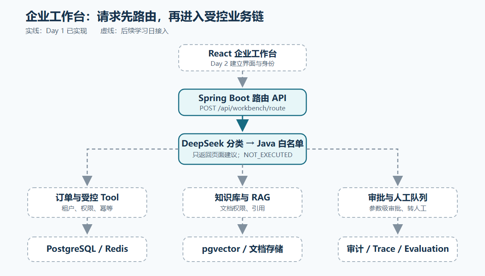

# Phase 2 · Priority 1 · Day 1：企业工作台架构与路由契约

> 日期：2026-10-22
> 学习计划：`01-每周学习/第二阶段-Agent企业实战/优先级1-企业项目主链路整合.md`
> 代码：`com.enterprise.agent.workflow.WorkbenchRoutingService`
> API：`04-项目/enterprise-agent/docs/workbench-api-contract.md`

## 一、回顾已学会的东西

第一阶段分别跑通了订单 Agent、RAG 问答、工单条件分支、审批与审计。问题是它们还像几个各自营业的柜台：订单有 `/agent/order`，知识有 `/rag/chat`，通用聊天有 `/chat`。产品界面不能让客服猜该按哪个后台接口。

## 二、为什么自然引出工作台路由

企业工作台像银行大堂的取号机。客户先说需求，取号机告诉他去哪个柜台；取号本身不等于柜员已经核验身份、查到余额或办完转账。Day 1 先把这张“取号单”的接口做稳定，后面几天再接真实业务。

本次请求流：

```text
前端未来提交 message
  → WorkbenchRouteController 校验非空、长度
  → WorkbenchRoutingService 调用 TicketClassifierAssistant
  → LangChain4j AI Service 向 DeepSeek 发送分类请求
  → TicketCategory.fromModelOutput 严格收敛 ORDER/KNOWLEDGE/HUMAN
  → Java 映射建议页面与人工标记
  → 返回 executionStatus=NOT_EXECUTED
```

## 三、产品架构和页面地图



需要放大时可打开 [SVG 矢量原图](images/Phase2-P1D1-企业工作台架构.svg)。图中的实线是 Day 1 已实现的路由 API 与分类链；虚线是 Day 2～8 将逐步接入的前端、订单、知识库、审批、存储和审计。

页面地图：登录与演示身份 → 运营总览 → AI 工作台；工作台可进入订单中心、知识库中心、审批中心、Trace/审计、Evaluation 与 MCP/Skill 管理。5种角色分别是客服、主管、知识管理员、审计员和系统管理员。每个角色看到的页面只是界面便利，真正的数据权限必须在 Java API 和数据查询处再次验证。

今天只实现图中的“路由预判”一小段。订单 Tool、RAG、审批和持久化均已有学习期实现，但还没有通过这个新 API 串为一条生产链路。

## 四、通俗讲解：模型说方向，Java 决定边界

模型输出可能是 `ORDER`，也可能是 `ORDER or KNOWLEDGE`。Java 的 `TicketCategory.fromModelOutput(...)` 只认三个准确枚举；多一句解释也会落到 `HUMAN`。原因是前端需要稳定的页面名，而高风险意图不能凭模型模糊文本自动走订单操作。

三种演示输入：

| 用户原话 | 模型类别 | 建议页面 | 是否执行了业务 |
| --- | --- | --- | --- |
| 查询 O1001 金额和状态 | ORDER | ORDERS | 否 |
| 公司的差旅报销制度是什么 | KNOWLEDGE | KNOWLEDGE | 否 |
| 立即取消 O1003 并退款 | HUMAN | HUMAN_QUEUE | 否 |

企业价值：主管看到高风险请求进入人工队列，客服不会因为“模型识别了订单”就误以为已有写入权限。后续接入身份、审批和业务 Tool 时，这条边界仍然保留。

## 五、代码与语法拆解

### 5.1 `record`：固定接口形状

`WorkbenchRouteRequest` 是请求记录，只有 `message`；`WorkbenchRouteResult` 是响应记录，含类别、建议页面、人工标记和执行状态。`record` 自动提供构造器及 `message()` 等访问方法，适合不可变的传输对象。常见误用是把 `tenantId`、`roles` 放进用户可提交的请求，让前端自报身份；本接口没有这样做。

### 5.2 `@Valid @RequestBody` 与字段约束

`@RequestBody` 把 JSON 读成 `WorkbenchRouteRequest`；`@Valid` 让 Spring 执行 `@NotBlank` 和 `@Size(max=2000)`。空白问题在进入模型前返回 HTTP 400。这里是请求格式门槛，不是登录鉴权；登录和受信租户将在 Day 2 接入。项目已经包含 `spring-boot-starter-validation`。

`@ExceptionHandler(MethodArgumentNotValidException.class)` 只处理本 Controller 的字段校验失败；`@ResponseStatus(BAD_REQUEST)` 固定 HTTP 400，响应体为 `{"error":"INVALID_MESSAGE"}`。这样前端得到稳定错误码，错误响应也不回显可能敏感的用户问题。它不替代后续的统一异常与审计设计。

### 5.3 `AiServices.builder(TicketClassifierAssistant.class)`

`TicketClassifierAssistant` 是 Java 接口，方法 `classify(String)` 返回字符串。`AiServices.builder(...).chatModel(model).build()` 为接口创建代理；构造代理时不向 DeepSeek 发送问题，直到调用 `classifier.classify(message)` 才真正请求模型。接口上的 `@SystemMessage` 指定分类规则，`@UserMessage` 指明用户问题参数。此写法在第一阶段 Week 6.5 Day 1 已出现；本次复用现有分类器，避免再维护一套会漂移的 Prompt。详见 [LangChain4j AI Services 官方说明](https://docs.langchain4j.dev/tutorials/ai-services/)。

服务还留有一个只供离线测试注入固定分类器的构造器。Spring 看到两个构造器时，需要 `@Autowired` 标明正式使用哪个；否则路由专项测试可能通过，但整个 Spring Boot 应用启动失败。本次全量回归就发现并修正了这个问题。它说明“测一个类”和“让全应用装配起来”是两种不同的验证。

### 5.4 `switch` 与白名单

`TicketCategory.fromModelOutput` 先把模型文本变为 `ORDER/KNOWLEDGE/HUMAN`。随后 `switch(category)` 把三类映射为 `ORDERS/KNOWLEDGE/HUMAN_QUEUE`。异常输出不会流向业务 Tool；所有返回都固定为 `NOT_EXECUTED`。这个字段不是装饰，而是告诉 Day 2 前端“你得到的是导航建议”。

### 5.5 `@WebMvcTest` 与 `MockMvc`

`WorkbenchRouteControllerTest` 用轻量 Web 测试模拟 HTTP 请求，检查 JSON 字段和空白输入的 400；`WorkbenchRoutingServiceTest` 用固定分类器验证 Java 映射规则。两者都不调用模型。真实模型另由 `WorkbenchRoutingLiveTest` 检查。三层各管一件事，出问题时更容易定位。

## 六、每个重点测试为什么得到这个结果

### 6.1 `orderAndKnowledgeQuestionsProduceReadOnlyNavigation()`

目的：订单和制度问题得到稳定页面建议。准备：固定分类器分别返回 `ORDER` 与 `KNOWLEDGE`。调用链：`route` → 枚举严格解析 → `switch` 映射。断言：`ORDERS/KNOWLEDGE` 且均为 `NOT_EXECUTED`。结果原因：服务没有注入订单 Agent 或 RAG，因此路由阶段根本没有业务执行入口。

### 6.2 `ambiguousOrBlankInputRoutesToHuman()`

目的：含糊输出关闭式转人工。准备：分类器返回 `ORDER or KNOWLEDGE`；空输入分支的分类器一旦被调用就抛错。调用链：含糊文本经 `fromModelOutput` 变 `HUMAN`；空输入在调用模型前短路。断言：`HUMAN_QUEUE`、`requiresHumanReview=true`。结果原因：Java 只接受精确枚举。

### 6.3 `routeApiReturnsContractAndRejectsBlankQuestion()`

目的：确保 Day 2 前端可按固定 JSON 契约开发。准备：Mock 路由服务返回订单建议。调用链：MockMvc 发 POST → Spring 解析与校验 → Controller 调用服务 → 序列化响应。断言：四个响应字段准确；空白或超过2000字符的问题返回 400 与固定 `INVALID_MESSAGE`。结果原因：有效请求进入 Controller，无效请求在 `@Valid` 处被拒绝并由本地异常处理器返回安全错误码。

真实 `realModelRoutesOrderKnowledgeAndRiskyAction()` 则把固定分类器换成 DeepSeek，实测三种输入得到 `ORDERS/KNOWLEDGE/HUMAN_QUEUE`，且均为 `NOT_EXECUTED`。

## 七、测试方式、实测结果与当前边界

在 `F:\ChatGPT\学习之路\04-项目\enterprise-agent`：

```powershell
# 离线：路由服务与 HTTP 契约；普通环境 LiveTest 按设计跳过
mvn test "-Dtest=WorkbenchRoutingServiceTest,WorkbenchRouteControllerTest,WorkbenchRoutingLiveTest"

# 真实 DeepSeek：从 .env 加载 Key，检查三种意图
.\scripts\test-live.ps1 -Test WorkbenchRoutingLiveTest

# 包含 Day 1 契约的离线 CI 门禁
.\scripts\eval-ci.ps1
```

实测：离线3个测试通过；真实模型1个 LiveTest 通过，订单 → `ORDERS`、制度 → `KNOWLEDGE`、取消退款 → `HUMAN_QUEUE`。

本地与 GitHub CI 门禁运行 33 个 Java 测试和 5 个 Python Script 测试；全量 Java 回归共 235 个测试、0 失败、0 错误，38 个 LiveTest 在普通环境按设计跳过。真实模型测试单独通过，不计入上述普通环境的 38 个跳过。

当前新路由接口尚未接登录、租户、配额和统一 Trace，因此它只用于学习与前端契约验证。现有 `/agent/order` 与 `/rag/chat` 也仍是学习期接口；Day 2～8 会逐步加受信身份、权限和统一工作台入口。不能把路由预判的成功写成“完整企业主链路已完成”。

## 八、小结 → 过渡到 Day 2

今天确定了产品的角色、页面和后端模块边界，并实现第一张可测试的“取号单”。Day 2 会让前端真正拿到这张取号单，同时建立登录与受信身份；再往后，订单、RAG、审批和审计才能安全地从同一个工作台串起来。

## 资料来源

- Level 1：LangChain4j AI Services：https://docs.langchain4j.dev/tutorials/ai-services/
- Level 1：Spring Boot Validation：https://docs.spring.io/spring-boot/reference/io/validation.html
